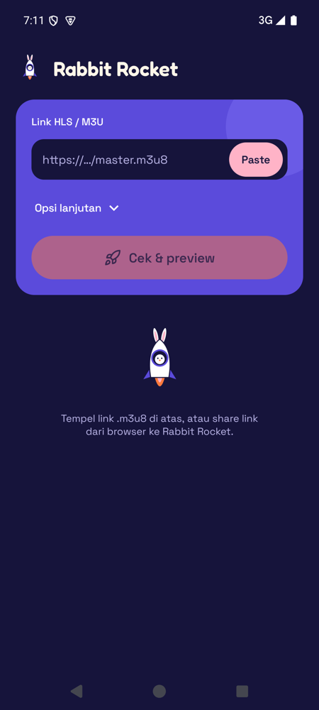
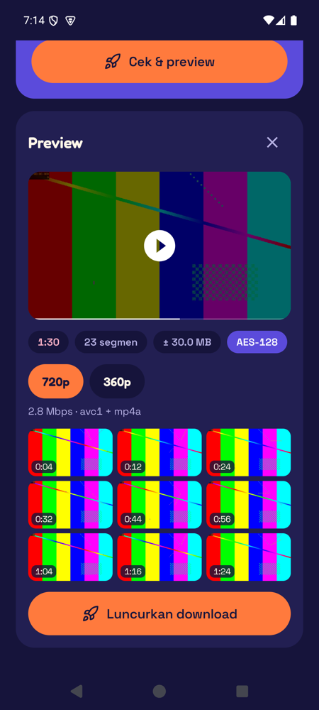
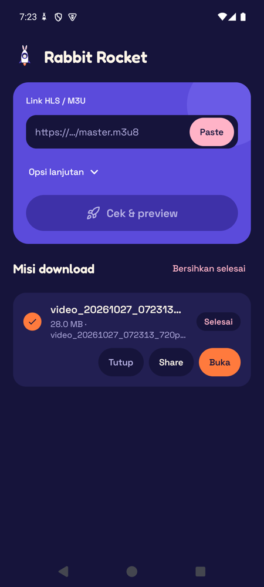

# Rabbit Rocket

Android app untuk download video dari link **HLS (.m3u8)** atau **M3U**, dengan preview sebelum download.

<p>
  
  
  
</p>

## Fitur

- **Preview dulu**: putar stream-nya, lihat durasi, jumlah segmen, perkiraan ukuran, dan grid cuplikan 3x3 (tap cuplikan untuk loncat ke menit itu).
- **Pilih kualitas** dari master playlist (1080p, 720p, …).
- **AES-128** terenkripsi didukung; DRM (SAMPLE-AES/Widevine) tidak.
- **Simpan sebagai MP4** (transmux tanpa re-encode); kalau gagal, file `.ts` tetap disimpan. Stream fMP4 langsung jadi `.mp4`.
- **Notifikasi**: progress, tombol Batal, lalu "Mendarat!" dengan tombol Buka/Share. Di Android 16 pakai ProgressStyle dengan tracker roket.
- **Bisa dilanjutkan**: segmen yang sudah terunduh tidak diunduh ulang saat Lanjutkan.
- **Share dari browser**: share link ke Rabbit Rocket, langsung dicek.
- Opsi Referer / User-Agent untuk situs yang mewajibkannya.

File tersimpan di `Download/Rabbit Rocket`.

## Build

```bash
./gradlew assembleRelease
```

Butuh JDK 17 dan Android SDK 36. Tanpa `keystore.properties`, build release ditandatangani dengan debug key.
Minimum Android 10 (API 29).

## Catatan

Gunakan hanya untuk konten yang kamu punya hak untuk mengunduhnya.
