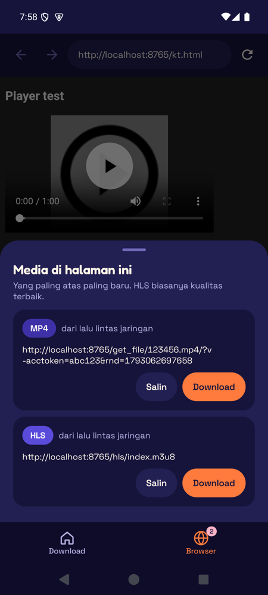

# Rabbit Rocket

Android app untuk download video dari link **HLS (.m3u8)**, **M3U**, atau **file langsung** (MP4, MKV, WebM, …), dengan preview sebelum download dan browser bawaan yang mencarikan link videonya.

<p>
  
  
  
  
</p>

## Fitur

- **Preview dulu**: putar stream-nya, lihat durasi, jumlah segmen, perkiraan ukuran, dan grid cuplikan 3x3. Tap cuplikan untuk melihatnya layar penuh dan tajam (sampai 1280 px): cubit atau double-tap untuk zoom, geser untuk pindah cuplikan, lalu **Putar dari sini**.
- **Browser bawaan**: buka halaman videonya, Rabbit Rocket mencatat link HLS/MP4 dari elemen `<video>` dan lalu lintas jaringan. Dari daftar "media ditemukan", tinggal **Salin** atau **Download** (Referer, cookie, dan User-Agent halaman ikut terbawa, jadi link bertoken tetap jalan).
- **Multi-tab, bookmark, dan tab yang awet**: tab tetap ada walau pindah ke Download, layar diputar, atau app ditutup.
- **Blokir iklan & popup** (aktif bawaan): daftar AdGuard DNS diunduh otomatis dan diperbarui mingguan; popup skrip dibuang, link `target=_blank` asli dibuka di tab baru.
- **DNS-over-HTTPS**: Cloudflare (bawaan), AdGuard, Google, Quad9, atau DNS jaringan. Dipakai browser dan download, membantu membuka situs yang diblokir lewat DNS operator.
- **Simpan untuk nanti**: simpan link dari preview atau dari Browser, lalu preview/download kapan saja. Daftarnya tetap ada setelah app ditutup.
- **File langsung** (MP4/MKV/WebM/MOV/MP3…): preview, grid cuplikan, ukuran pasti, dan download **4 koneksi paralel** kalau server mendukung Range.
- **Pilih kualitas** dari master playlist (1080p, 720p, …); preview menampilkan resolusi (mis. 720p · 1280×720).
- **Player bawaan** untuk hasil download: rotasi ikut cara HP dipegang (tidak pernah dipaksa landscape), tombol kunci rotasi & putar layar, double-tap ±10 detik, geser kiri/kanan untuk kecerahan/volume, kecepatan 0.5×–2×, pas/isi layar, lanjut dari posisi terakhir, dan Picture-in-Picture. Tetap bisa **buka dengan app lain** (VLC, dll.) dari kartu download, player, atau notifikasi.
- **Kartu download selesai bergambar**: cuplikan videonya, durasi, resolusi, dan ukuran. Tap gambarnya untuk grid 9 cuplikan dari file itu, lalu putar dari menit mana pun.
- **Jeda & Lanjutkan**: download bisa dijeda (dari kartu atau notifikasi) dan dilanjutkan kapan saja, termasuk setelah app ditutup. **Batal** benar-benar membatalkan dan membuang file sementara.
- **Coba ulang otomatis**: kalau koneksi putus atau server error (5xx/408/429), dicoba lagi 3x (5, 15, 30 detik) dan lanjut dari bagian yang sudah ada. Saat offline, menunggu internet kembali tanpa menghabiskan jatah. Link 404/403 atau DRM langsung gagal.
- **Hapus & ganti nama download**: hapus dari daftar saja atau sekalian file videonya; ganti nama file yang sudah selesai.
- **AES-128** terenkripsi didukung; DRM (SAMPLE-AES/Widevine) tidak.
- **Simpan sebagai MP4** (transmux tanpa re-encode); kalau gagal, file `.ts` tetap disimpan. Stream fMP4 langsung jadi `.mp4`.
- **Notifikasi**: progress, tombol Batal, tombol Jeda, hitung mundur saat mencoba ulang, lalu "Mendarat!" dengan tombol Putar / App lain / Share. Di Android 16 pakai ProgressStyle dengan tracker roket.
- **Bisa dilanjutkan**: segmen HLS atau potongan file yang sudah terunduh tidak diunduh ulang saat Lanjutkan.
- **Share dari browser**: share link ke Rabbit Rocket, langsung dicek.
- Opsi Referer / User-Agent untuk situs yang mewajibkannya.

File tersimpan di `Download/Rabbit Rocket`.

## Build

```bash
./gradlew assembleRelease
```

Butuh JDK 17 dan Android SDK 36. Tanpa `keystore.properties`, build release ditandatangani dengan debug key.
Minimum Android 10 (API 29).

## Catatan

Gunakan hanya untuk konten yang kamu punya hak untuk mengunduhnya.
